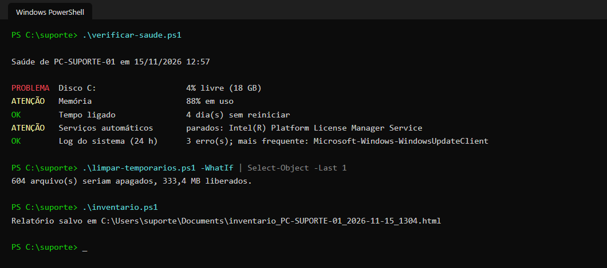

# Scripts de suporte de TI

Scripts PowerShell para tarefas que se repetem no atendimento de chamados. Rodam no Windows PowerShell 5.1, que já vem no Windows, e no PowerShell 7.



| Script | Para quê | Altera a máquina? |
|---|---|---|
| [`verificar-saude.ps1`](verificar-saude.ps1) | Primeiro atendimento de chamado de lentidão: disco, memória, tempo ligado, serviços parados e erros recentes no log, com OK, ATENÇÃO ou PROBLEMA | Não |
| [`inventario.ps1`](inventario.ps1) | Relatório HTML com sistema, número de série, hardware, discos, rede e programas instalados, para cadastro de ativo ou troca de equipamento | Não, só cria o relatório |
| [`limpar-temporarios.ps1`](limpar-temporarios.ps1) | Libera espaço apagando temporários com mais de 7 dias. Tem modo de simulação | Sim, por isso tem `-WhatIf` |

## Como usar

```powershell
# Uma vez por sessão, se o Windows bloquear scripts:
Set-ExecutionPolicy -Scope Process Bypass

.\verificar-saude.ps1
.\inventario.ps1                       # salva em Documentos
.\limpar-temporarios.ps1 -WhatIf       # mostra o que seria apagado
.\limpar-temporarios.ps1               # apaga de verdade
```

Exemplo da checagem de saúde:

```
OK        Disco C:                   42% livre (198 GB)
OK        Memória                    61% em uso
ATENÇÃO   Tempo ligado               9 dia(s) sem reiniciar
OK        Serviços automáticos       todos rodando
OK        Log do sistema (24 h)      3 erro(s); mais frequente: Service Control Manager
```

## Decisões

- **Programas pelo registro, não pelo `Win32_Product`:** consultar essa classe dispara a verificação de todos os pacotes MSI instalados, é lenta e pode até reparar programas sem querer.
- **Limpeza conservadora:** só apaga arquivos com mais de N dias e pula o que está em uso. A pasta do Windows só entra quando o script roda como administrador.
- **Exportar a checagem de saúde:** com `-PassThru` ela devolve os resultados como objetos: `.\verificar-saude.ps1 -PassThru | Export-Csv saude.csv -NoTypeInformation`.

Desenvolvido com apoio do Claude Code.
